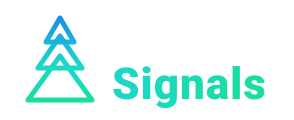

  

# Trifecta Signals

Trifecta Signals screens ~6,600 U.S. stocks every day for oversold setups
and identifies bullish reversals. Every signal is graded against the
S&P 500 over the 180 days that follow it, and the full record — every
signal, graded — is public on the site.

This account publishes our open data feeds and the examples for working
with them.

## Open data feeds

- **Trifecta Fear Gauge — free JSON feed.** A 0–100 daily read on U.S.
  market sentiment, published after each close, with the full history
  back to January 2020:
  [trifectasignals/fear-gauge-feed](https://github.com/trifectasignals/fear-gauge-feed)
- The live feed: https://trifectasignals.com/fear-gauge.json
- The gauge page, with chart and history: https://trifectasignals.com/fear-gauge

## Explore

- [Home](https://trifectasignals.com)
- [Fear Gauge](https://trifectasignals.com/fear-gauge)
- [Trifecta Oscillator](https://trifectasignals.com/oscillator)
- [VIX tracker](https://trifectasignals.com/vix)
- [Resources](https://trifectasignals.com/resources)
- [Free guide](https://trifectasignals.com/guide-download)

## Contact

support@trifectasignals.com
